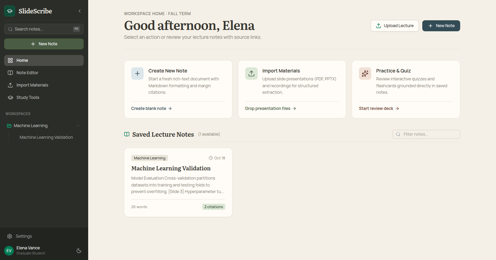
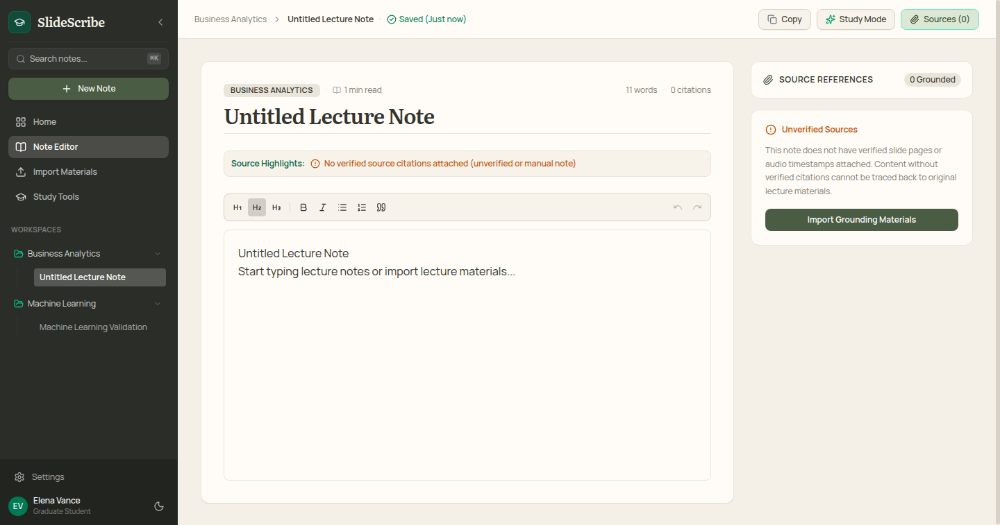
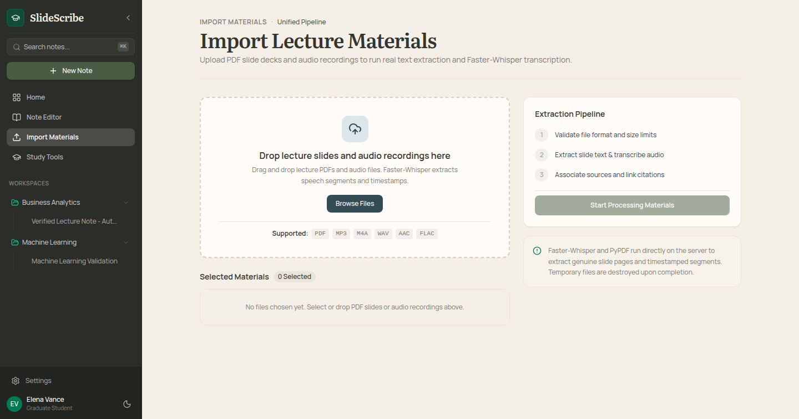
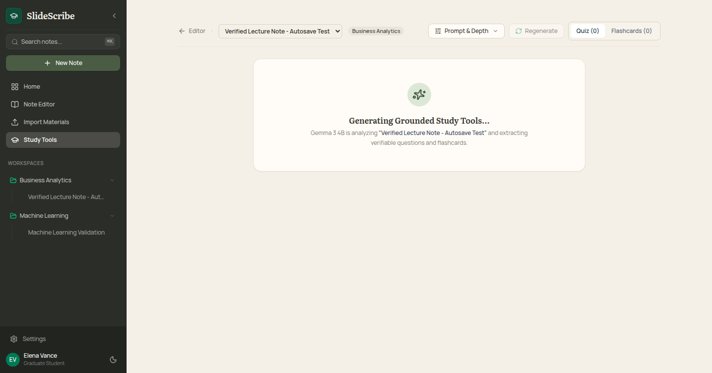
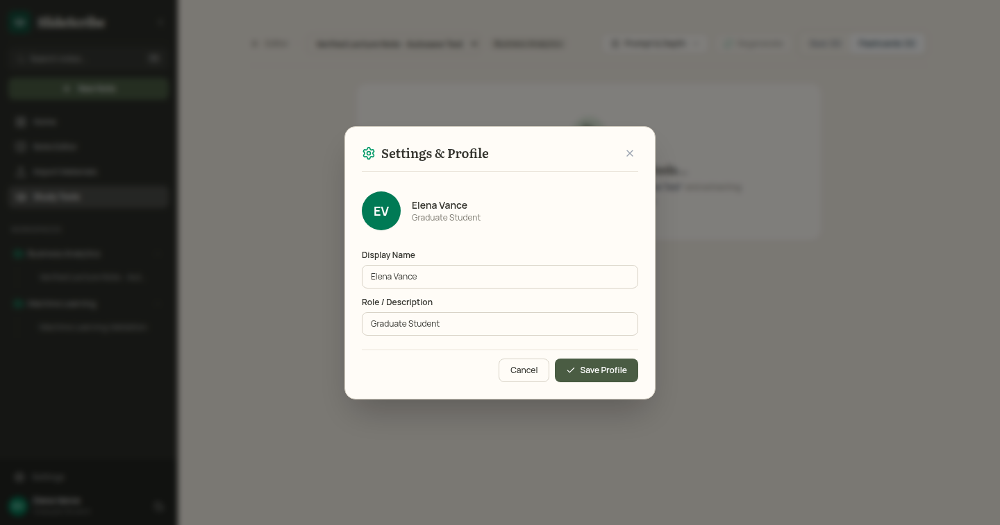

# SlideScribe

**Turn lecture slides and recordings into editable, source-grounded study notes.**

SlideScribe is an AI-assisted lecture companion that synthesizes lecture slides (PDF) and audio recordings into structured, editable notes with verified source citations, interactive quizzes, and flashcards.

Unlike generic summarizers that detach content from its origins, SlideScribe anchors every synthesized insight to exact slide numbers (`[Slide N]`) or audio timestamps (`[MM:SS]`), allowing students to verify and trust their notes.

---

## Application Screenshots

Captured from automated browser smoke tests running Google Chrome:

| Workspace Home | Note Editor & Grounded Citations |
| :---: | :---: |
|  |  |

| Import Materials & Extraction | Study Companion (Quiz & Flashcards) |
| :---: | :---: |
|  |  |

| Profile & Settings |
| :---: |
|  |

---

## Status & Features

### Implemented & Verified

- **Unified Editorial Shell**: Persistent sidebar with collapsible workspaces, note listings, view switcher, and a warm editorial theme (`Literata` serif, `Manrope` sans).
- **Workspace & Note Organization**:
  - Three-dots context menus on workspaces: Rename workspace and cascading delete (removes all notes in workspace).
  - Three-dots context menus on notes: Inline rename and delete.
  - Profile Settings modal to customize display name, role, and initials.
- **Rich-Text Note Editor**:
  - Tiptap rich-text editor supporting headings, lists, blockquotes, and formatting.
  - Automatic debounced autosave with real-time status indicators (`Saved`, `Saving...`, `Save error`).
  - Metadata header displaying reading time, word count, citation count, and a one-click "Copy Note" button.
  - Side drawer displaying grounded citations linked to specific slides and audio segments.
- **Lecture Material Extraction**:
  - PDF slide processing with page-by-page text extraction (`pypdf`) preserving slide numbers.
  - Audio transcription via `faster-whisper` (`base` model on CPU/CUDA) with timestamped segments.
  - Validation enforcing 100MB file size limits and automatic temporary file cleanup.
- **Grounded Note Generation (Gemma)**:
  - Local LLM inference using Ollama with `gemma3:4b`.
  - Strict grounding prompt: synthesizes structured lecture notes with verified `[Slide N]` and `[MM:SS]` citation tags, separating extracted facts from AI interpretation.
- **Study Mode**:
  - Generates multiple-choice quiz questions with instant answer validation and source references.
  - Generates interactive flashcards with 3D flip card animations and card-by-card navigation.
  - **Prompt & Depth Controls**: Toggle between Standard (3-4 questions) and In-Depth (5-6+ questions), with an optional custom focus prompt to target specific topics or formulas.
- **Database Persistence**:
  - Async MongoDB Atlas integration via `motor`, with automatic fallback to memory storage when disconnected.
  - Health check endpoint at `/api/health` reporting live database status.
- **Automated Verification**:
  - 10-test backend pytest suite covering health, note CRUD, workspace cascading operations, PDF/audio extraction, and live Gemma synthesis.
  - Headless Chrome browser smoke test driving the application via Chrome DevTools Protocol (CDP), testing navigation, editing, autosave, tabs, and telemetry.

### Planned Features (Roadmap)

- [ ] Cloud deployment on Render / Vercel.
- [ ] Direct PowerPoint (`.pptx`) binary file parsing.
- [ ] Spaced repetition scheduling and long-term mastery analytics.
- [ ] Real-time collaborative note editing.

---

## Technology Stack

| Layer | Component | Technology |
|---|---|---|
| **Frontend** | Framework & Bundler | React 19, TypeScript, Vite |
| | Rich-Text Editor | Tiptap (`@tiptap/react`, `@tiptap/starter-kit`) |
| | Styling & Icons | Tailwind CSS v4, Lucide React |
| **Backend** | API Framework | Python 3.12+, FastAPI, Uvicorn |
| | Database & Persistence | MongoDB Atlas (via `motor` async driver) |
| | PDF Extraction | `pypdf` |
| | Audio Transcription | `faster-whisper` (CTranslate2) |
| | Local LLM Inference | Ollama (`gemma3:4b`) |
| **Testing** | Unit & Integration | `pytest`, `httpx`, `anyio` |
| | Browser Smoke Testing | Google Chrome via Chrome DevTools Protocol (`websockets`, `httpx`) |

---

## Getting Started

### Prerequisites

- **Node.js**: v18+ (tested on Node v20+)
- **Python**: 3.12+ (tested on Python 3.14)
- **Ollama**: Installed and running locally with the `gemma3:4b` model:
  ```bash
  ollama run gemma3:4b
  ```
- **MongoDB Atlas** (Optional): A free cluster connection string. If omitted, the application falls back to local in-memory storage.
- **Google Chrome**: (Optional, for running browser smoke tests).

---

### Installation & Local Setup

#### 1. Clone Repository

```bash
git clone git@github.com-personal:edgiaxel/SlideScribe.git
cd SlideScribe
```

#### 2. Backend Setup

```bash
cd backend

# Create and activate virtual environment
python3 -m venv .venv
source .venv/bin/activate

# Install dependencies
pip install -r requirements.txt

# Configure environment variables
cp ../.env.example .env
```

Edit `backend/.env` with your settings (placeholders shown below):

```ini
# Server Settings
HOST=0.0.0.0
PORT=8000

# MongoDB Atlas (leave empty to use local memory fallback)
MONGODB_URI=mongodb+srv://<username>:<password>@cluster0.mongodb.net/slidescribe?retryWrites=true&w=majority
MONGODB_DB_NAME=slidescribe

# Processing & Transcription Settings
WHISPER_MODEL_SIZE=base
WHISPER_DEVICE=cpu
WHISPER_COMPUTE_TYPE=int8
MAX_FILE_SIZE_BYTES=104857600

# Gemma / Ollama Inference Settings
OLLAMA_BASE_URL=http://localhost:11434
GEMMA_MODEL=gemma3:4b
LLM_TIMEOUT_SECONDS=60
MAX_INPUT_CHARS_PER_PROMPT=12000
```

Start the FastAPI backend:

```bash
.venv/bin/uvicorn app.main:app --host 0.0.0.0 --port 8000 --reload
```

Verify backend health:

```bash
curl http://localhost:8000/api/health
```

Expected output:
```json
{
  "status": "healthy",
  "database": "mongodb_atlas",
  "mongodb_configured": true,
  "whisper": {
    "model_size": "base",
    "device": "cpu",
    "compute_type": "int8"
  }
}
```

#### 3. Frontend Setup

In a separate terminal:

```bash
cd frontend

# Install npm dependencies
npm install

# Start Vite dev server
npm run dev
```

The frontend application will be live at:
[http://localhost:5173](http://localhost:5173)

---

## Verification & Testing

### Backend Automated Tests

Run the full pytest suite (includes note CRUD, workspace cascade deletion, PDF/audio extraction, and live Gemma synthesis):

```bash
cd backend
PYTHONPATH=. .venv/bin/pytest tests/ -v
```

### Frontend Type Check & Production Build

```bash
cd frontend
npm run build
```

### Browser Smoke Test

The repository includes a self-contained browser smoke test (`scripts/browser_smoke_test.py`) that launches Google Chrome headlessly, exercises the live application via Chrome DevTools Protocol, verifies note editing and autosave, and captures screenshots to `artifacts/screenshots/`:

```bash
# Ensure both backend (:8000) and frontend (:5173) are running, then:
backend/.venv/bin/python3 scripts/browser_smoke_test.py
```

---

## Project Structure

```text
SlideScribe/
├── artifacts/
│   └── screenshots/         # Automated browser smoke test captures
├── backend/
│   ├── app/
│   │   ├── config.py        # Environment variables & runtime constants
│   │   ├── extractors.py    # PDF (pypdf) & audio (faster-whisper) extraction
│   │   ├── generator.py     # Grounded Gemma synthesis & study question generation
│   │   ├── main.py          # FastAPI application routes & middleware
│   │   ├── models.py        # Pydantic schemas for notes, sources & study sets
│   │   └── storage.py       # MongoDB Atlas persistence & memory fallback
│   ├── tests/               # Pytest test suite
│   ├── requirements.txt     # Python dependencies
│   └── .env                 # Backend environment secrets (excluded from Git)
├── frontend/
│   ├── src/
│   │   ├── api/             # Frontend HTTP client (notesApi.ts)
│   │   ├── components/      # UI Views (Home, NoteEditor, Import, Study, Sidebar)
│   │   ├── App.tsx          # Root application component & state router
│   │   └── types.ts         # TypeScript data interfaces
│   ├── package.json         # Frontend dependencies & scripts
│   └── vite.config.ts       # Vite bundler configuration
├── scripts/
│   └── browser_smoke_test.py# CDP-based automated Chrome smoke testing
├── .env.example             # Safe template with placeholder configuration
├── .gitignore               # Strict exclusion of secrets, build outputs & caches
├── AGENTS.md                # Development rules and workflow guidelines
├── PROJECT_BRIEF.md         # Architecture, design tokens & product milestones
└── README.md                # Project documentation
```

---

## Known Limitations

1. **Local Inference Speed**: Running `faster-whisper` and `gemma3:4b` on CPU can take 15–25 seconds for large PDFs or audio files. GPU acceleration (CUDA) is supported via `WHISPER_DEVICE=cuda` when available.
2. **Slide Format**: Currently supports PDF presentations natively. PowerPoint `.pptx` presentations must be exported to PDF before importing.
3. **Deployment**: Currently validated for local execution; cloud deployment on Render is planned for a future milestone.

---

## License

The project license has not yet been specified. Licensing information will be added once finalized.